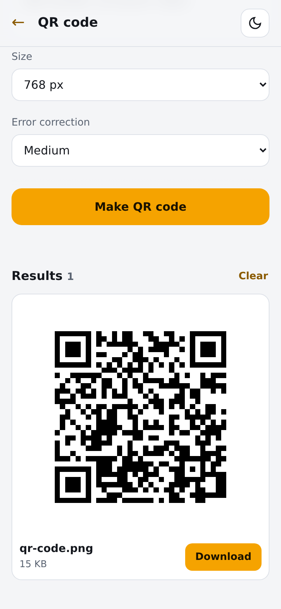

<div align="center">

# Convert Desk

**Offline file tools for your phone or laptop. Your files never leave the device.**


**[Open the live app →](https://mtarvecha660-lgtm.github.io/convert-desk/)**


<br>



</div>

---

## ✨ What it does

18 tools in four groups. Every one runs in your browser.

| Group | Tool | What it does |
|-------|------|--------------|
| **Convert** | Image converter | JPG, PNG, WebP, BMP or GIF in; PNG, JPG or WebP out |
| | Images to one PDF | Several images, in list order, into one PDF (A4 with margins, or each image's own size) |
| | PDF to images | One PNG or JPG per page, at 72, 144 or 216 dpi; page ranges |
| | PDF to text | Copies the text layer of every page into a `.txt` file |
| | Word to text | Reads a `.docx` file and saves its text |
| | Text to PDF | Plain text (TXT, MD, LOG and similar) or JSON, as a monospace PDF |
| | Spreadsheet converter | CSV, XLSX or XLS in; XLSX, CSV or JSON out (first sheet for CSV and JSON) |
| | JSON and CSV | A JSON array of objects to CSV, or CSV to JSON |
| **Images** | Compress and resize | JPG, WebP or PNG, with a quality slider and an optional max width |
| | Rotate and flip | Quarter turns left or right, upside down, flip left-right or top-bottom |
| | Crop | Cut a percentage off each side |
| **PDF** | Merge PDFs | Joins several PDFs in list order |
| | Split PDF | Pull out a page range as one PDF, or save each page as its own PDF |
| | Edit pages | Keep, reorder or delete pages by listing them; rotate the kept pages |
| | Numbers & watermark | Page numbers ("1, 2, 3" or "Page 1 of 3") and a diagonal text watermark |
| **Utilities** | QR code | A PNG QR code for text or a link (up to 1,500 characters) |
| | Base64 text | Encode text to Base64, or decode it back (UTF-8) |
| | File checksum | SHA-1, SHA-256, SHA-384 or SHA-512 of a file, or of text you type |

Across the app:

- **One file queue** shared by all tools: add files once, then pick a tool. Tools that fit your files are highlighted on the home screen.
- **Drag and drop** on desktop, or tap to choose on a phone.
- **Thumbnails** for images, and a **progress bar** for each file.
- **Before and after sizes** for every result, with the change in percent.
- **Remove** any file from the queue, **download** each result, or **Download all as ZIP**.
- **Error messages** as toasts, with the file name, so a bad file never fails silently.
- **Dark and light theme**, following your device by default; the button in the corner switches it.
- **Offline after the first visit**. It ships a web app manifest, so it can be added to your home screen.

## 🚀 Run it

Convert Desk is static files, with nothing to build. Serve the folder with any static server. Service workers need `localhost` or HTTPS:

```bash
git clone https://github.com/mtarvecha660-lgtm/convert-desk.git
cd convert-desk
python3 -m http.server 8000
# open http://localhost:8000
```

Or use the [live app](https://mtarvecha660-lgtm.github.io/convert-desk/).

## 🧩 Project structure

```
index.html            page shell and script order
app.js                home screen, file queue, progress, results, ZIP, theme
js/util.js            shared helpers: sizes, page ranges, canvas, downloads, ZIP
js/tools-convert.js   convert tools
js/tools-image.js     compress, rotate, crop
js/tools-pdf.js       merge, split, edit pages, numbers and watermark
js/tools-util.js      QR code, Base64, checksums
styles.css            layout and both themes
sw.js                 service worker: offline cache, network first
manifest.webmanifest  install metadata and icons
libs/                 bundled libraries, no CDN
```

## 🛠️ Tech stack

- Vanilla JavaScript and CSS. No framework, no build step, no network calls at runtime.
- [pdf-lib](https://pdf-lib.js.org/) for writing and editing PDFs
- [pdf.js](https://mozilla.github.io/pdf.js/) for reading PDFs
- [SheetJS](https://sheetjs.com/) for CSV, XLSX and XLS
- [mammoth.js](https://github.com/mwilliamson/mammoth.js) for Word text
- [JSZip](https://stuk.github.io/jszip/) for the ZIP download
- [qrcode-generator](https://github.com/kazuhikoarase/qrcode-generator) for QR codes

## ✅ How it was tested

Headless Chrome, at 390×844 (phone) and 1280×800 (desktop), with real sample files: JPG, PNG, WebP, BMP, GIF, a multi-page PDF, an image-only PDF, DOCX, CSV, XLSX, XLS, JSON and TXT.

- Every tool above ran on sample files, and the outputs were checked: sizes and dimensions, page counts and page rotation, pixel positions after rotate and flip, text read back from the PDFs and DOCX, spreadsheet contents, hashes against Python's `hashlib`, and both QR codes decoded back to their text.
- Downloads: single files and the ZIP.
- Drag and drop, removing files, the theme switch, and error messages for bad input.
- Offline: the app reloaded and converted with the network switched off.
- No requests to any host other than the app's own.

## ⚠️ Limitations

- **Text to PDF** uses a built-in Latin font. Characters outside it, such as ₹ or Devanagari, come out as `?`.
- **PDF to text** reads the text layer only. Scanned PDFs have no text, and there is no OCR, so they are reported as having no text.
- **Spreadsheets and JSON** use the first sheet only.
- **HEIC** photos from iPhones are not accepted, because the browser cannot decode them.
- **PDF tools** may not open password-protected PDFs.
- **Compress** works on images only. PDF size reduction is not included.
- **Quality** applies to JPG and WebP. PNG output ignores the quality slider.
- **Big files** are handled one at a time, in the tab's memory. Very large files can take a while and may fail on older phones.
- **Updates** arrive on reload. The service worker is network first, so a normal reload picks up a new version when you are online.
- The project has no automated test suite in the repository. The checks above were run by hand against the live build.

<div align="center">

---

Made for everyday files: a PDF to merge, a photo to shrink, a spreadsheet to convert.

</div>
