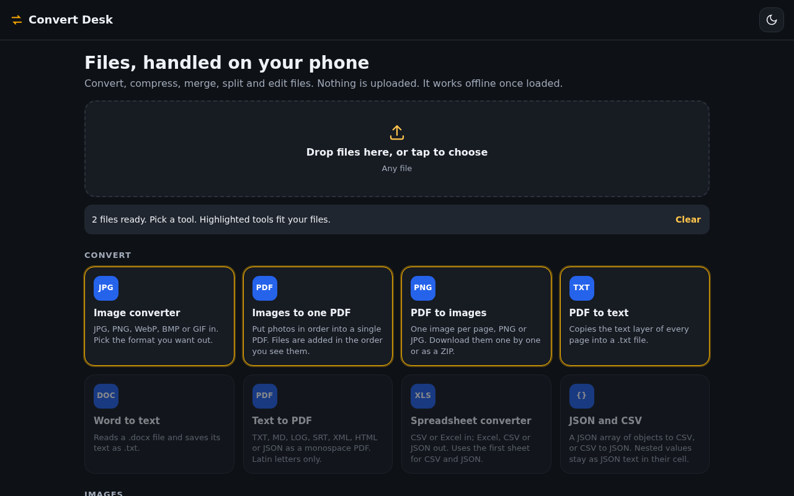

<div align="center">

# Convert Desk

**Convert files right in your browser. Nothing is uploaded.**


**[Live demo →](https://mtarvecha660-lgtm.github.io/convert-desk/)**



</div>

---

## ✨ Features

| From | To |
|------|----|
| Images: JPG, PNG, WebP, BMP, GIF (HEIC where the browser can read it) | PNG, JPG, WebP, PDF (quality and resize sliders) |
| PDF | PNG or JPG (one image per page), or plain text |
| CSV | XLSX or PDF |
| XLSX | CSV (first sheet) |
| DOCX | plain text |
| TXT, MD, JSON, LOG, SRT, XML, HTML | PDF |

- **Batch:** add several files at once, and pick a target format for each one.
- **Private:** the app makes no network requests; conversion runs in your browser tab.
- **Offline after the first visit:** a service worker caches the app and its libraries.
- **Installable:** ships a web app manifest and icons, so it can sit on your home screen.

## 🚀 Run it

Convert Desk is static files, so there is nothing to build. Serve the folder with any static server (service workers need `localhost` or HTTPS):

```bash
git clone https://github.com/mtarvecha660-lgtm/convert-desk.git
cd convert-desk
python3 -m http.server 8000
# open http://localhost:8000
```

Or use the [live demo](https://mtarvecha660-lgtm.github.io/convert-desk/).

## 🧩 Project structure

```
index.html            page layout and script tags
app.js                queue, format rules and all conversions
styles.css            styling
sw.js                 service worker (cache-first, offline)
manifest.webmanifest  install metadata and icons
libs/                 bundled libraries (see below)
```

## 🛠️ Tech stack

- Vanilla JavaScript and CSS, no build step
- [pdf-lib](https://pdf-lib.js.org/) (write PDFs), [pdf.js](https://mozilla.github.io/pdf.js/) (read PDFs), [SheetJS](https://sheetjs.com/) (XLSX/CSV), [mammoth.js](https://github.com/mwilliamson/mammoth.js) (DOCX to text)

## ⚠️ Limitations

- **Text to PDF** uses a built-in Latin font with simple line wrapping, so non-Latin scripts will not render correctly.
- **PDF to text** only reads a text layer. Scanned PDFs come out empty; there is no OCR.
- **XLSX to CSV** exports the first sheet only.
- **HEIC** works only in browsers that can decode it.
- **Big files** are limited by the device's memory, since everything runs in the tab.
- **Updates** are cache-first, so a new version can take a reload to appear.
- No automated tests yet.
